  

  
  
  

I'm a Computer Engineering student at the University of Puerto Rico at Mayagüez. I build backend and data systems and automate the work around them, from ETL pipelines and REST APIs to event-driven cloud functions and CI workflows, and I work on a production serverless AWS backend as an undergraduate researcher.

<table>
  <tr><td><b>Education</b></td><td>B.S. in Computer Engineering, UPRM · expected <b>December 2027</b></td></tr>
  <tr><td><b>Research</b></td><td>Undergraduate Research Assistant, <b>SCOPE Project</b> (Software Team), IoT Lab, UPRM</td></tr>
  <tr><td><b>Looking for</b></td><td><b>Summer 2027 internships</b> in backend, data engineering, automation, or cloud</td></tr>
  <tr><td><b>Learning</b></td><td>Flask · React · Azure data services</td></tr>
  <tr><td><b>Based in</b></td><td>Mayagüez, Puerto Rico</td></tr>
  <tr><td><b>Languages</b></td><td>Spanish (native) · English (proficient) · French (basic)</td></tr>
</table>

## Research · SCOPE Project, UPRM

Working on a production serverless AWS application inherited from a previous capstone team.

<table>
  <tr>
    <td align="center" width="25%"><h3>~40</h3>Lambda functions</td>
    <td align="center" width="25%"><h3>~12 GB</h3>of stored photos removed</td>
    <td align="center" width="25%"><h3>IAM</h3>auth + rate limiting on open routes</td>
    <td align="center" width="25%"><h3>CI</h3>GitHub Actions with automated tests</td>
  </tr>
</table>

- **Security:** Audited the architecture and secured unauthenticated API routes with IAM authorization and rate limiting, verified in production.
- **Privacy:** Designed S3 lifecycle rules and an event-driven Lambda that deletes processed images within seconds, removing ~12 GB of stored photos.
- **Performance:** Measured and analyzed API latency to separate cold-start from warm response times.
- **Engineering practice:** Set up GitHub Actions CI with automated tests; ship changes through pull requests and code reviews.

`AWS Lambda` `API Gateway` `S3` `SQS` `RDS PostgreSQL` `IAM` `GitHub Actions`

## Featured projects

### [Car Tracking System: REST API & ETL Pipeline](https://github.com/DBSpring26/db-project-spring2026-cartracking-3neuronas)
Team project (3 members) for Database Systems (CIIC 4060 / ICOM 5016), Spring 2026.
- Built the **ETL orchestration and data-validation step** that loads 9 Parquet datasets into **PostgreSQL 17 / PostGIS**, fixing data-quality bugs before load (dtype corruption, EWKB vs. WKB geometry, ID sequences).
- Created the initial **FastAPI** backend and Docker setup for a **28-endpoint REST API** (handler/DAO architecture, geospatial queries).
- Built a **Streamlit** dashboard (Plotly, Folium) and an **AI assistant with a custom MCP server** for natural-language data queries.

`Python` `FastAPI` `PostgreSQL` `PostGIS` `pandas` `Docker` `Streamlit` `MCP`

### [PA-RISC Pipelined Processor](https://github.com/jorge-burgos10/pa-risc-ppu)
A 5-stage pipelined PA-RISC processor with hazard detection, a 32-bit ALU, and a test bench.

`Verilog`

### [EV Charging Station Reservation System](https://github.com/jorge-burgos10/EV-Charging-Station-Reservation-System)
Console-based reservation platform for 5 UPRM campus charging stations, with conflict detection, an automated wait queue, and stack-based undo.

`Java` `Data Structures`

## Tech stack

  

<table>
  <tr><td><b>Languages</b></td><td>Python · Java · C · C++ · SQL · JavaScript · Verilog · PowerShell</td></tr>
  <tr><td><b>Backend & Data</b></td><td>FastAPI · REST APIs · PostgreSQL · PostGIS · pandas · ETL pipelines · Streamlit</td></tr>
  <tr><td><b>Cloud</b></td><td>AWS (Lambda, API Gateway, S3, IAM, CloudFormation, CloudWatch, RDS, SQS) · AWS CLI</td></tr>
  <tr><td><b>Automation</b></td><td>GitHub Actions CI · event-driven AWS Lambda · S3 lifecycle rules · ETL orchestration · Excel macros</td></tr>
  <tr><td><b>DevOps & Tools</b></td><td>Git/GitHub · Docker · Linux · POSIX</td></tr>
  <tr><td><b>AI</b></td><td>MCP servers · LLM tool calling · Claude Code · Cursor</td></tr>
</table>

---

  <a href="https://jorgeburgos.me">jorgeburgos.me</a> ·
  <a href="https://www.linkedin.com/in/jorge-burgos-b5a8748a">LinkedIn</a> ·
  <a href="mailto:jorgeburgos859@gmail.com">jorgeburgos859@gmail.com</a>

